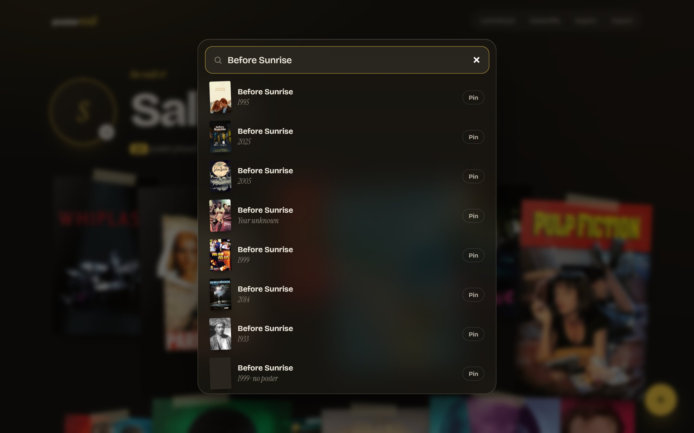
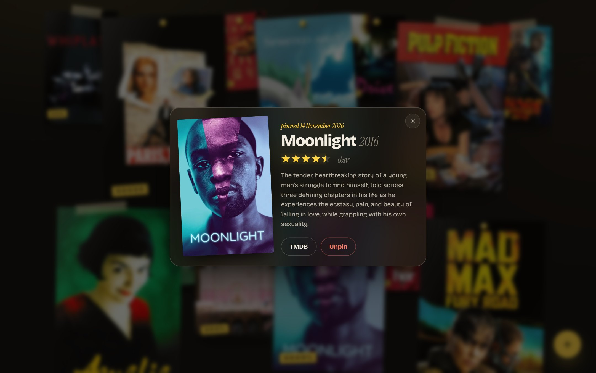
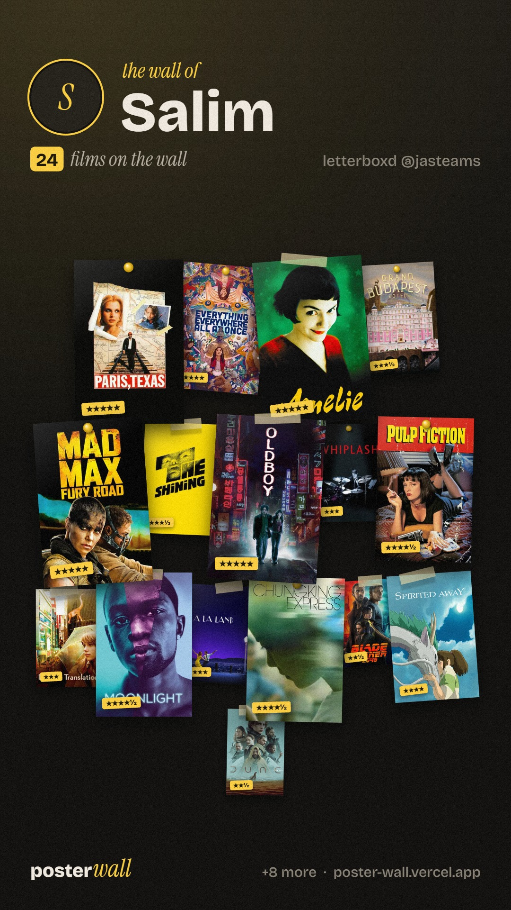
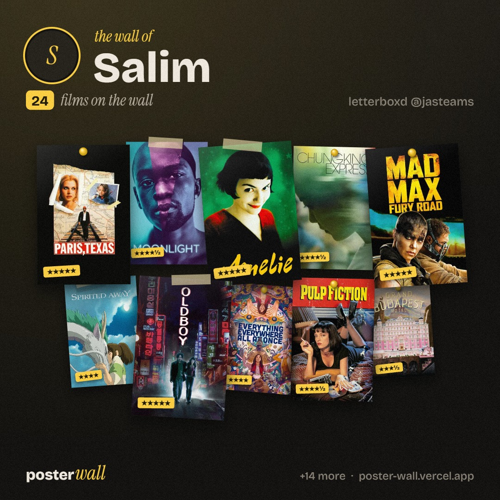
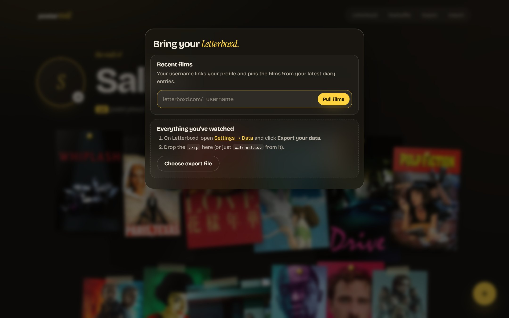

<div align="center">

# poster *wall*

**Your films, pinned like posters on a bedroom wall.**

A small, personal take on the film diary: no ratings and no reviews, just a page with your name, your face and a messy, lovingly crooked collage of the posters of every film you care about.

**[Live demo](https://poster-wall-psi.vercel.app)** · [Features](#features) · [Share](#share-your-wall) · [Run it](#run-it-locally) · [Deploy](#deploy-to-vercel) · [TMDB key](#get-a-tmdb-api-key) · [Letterboxd](#import-from-letterboxd) · [How it works](#how-the-wall-works) · [Credits](#credits)


</div>

---

## Features

- **One page, one person.** Your name (click to edit) and profile photo (click the avatar) on top, your poster wall below.
- **A wall that isn't a grid.** Every poster gets its own tilt, offset and size, and is held up with a strip of torn masking tape or a yellow push pin. Neighbours overlap a little, like a real wall.
- **Pinning takes two seconds.** Hit the yellow **+** (or press <kbd>N</kbd>), type a title and press <kbd>Enter</kbd>. The film you meant comes first: exact titles and well-known films rank above obscure namesakes.
- **Motion that feels physical.** A new poster drops from above, overshoots, wobbles and settles, and its tape lands last. Hovering lifts and straightens a poster. All motion is turned off under `prefers-reduced-motion`.
- **Your ratings set the size.** Every half star is the same visible step (about 14% bigger): ½★ is the smallest poster (0.56×), 5★ the biggest (1.8×), and higher-rated posters win overlaps. Each rated poster wears a little yellow ticket with its stars, unrated films stay small, and **Sort: rating** puts your favourites first. Ratings come from Letterboxd, or click a poster and rate it (half stars, arrow keys work too).
- **Share it.** Save a designed photo (Instagram/Facebook **story** 9:16, **square** 1:1 for X and feeds, or the **full wall**), send it through your phone's share sheet, post on X or Facebook, or copy a link that opens your wall read-only.
- **Bring your Letterboxd.** Link your username (it shows as a chip under your name) to pin the films from your latest diary entries, or drop your Letterboxd export `.zip` to pin *everything* you've ever watched. Imported posters rain onto the wall in a cascade.
- **Reshuffle.** Re-throws the whole wall: a new order *and* new tilts, offsets, tape and pins, with every poster gliding to its new spot. It's seeded, so the wall stays put between visits until you reshuffle again (**Sort** switches back to recent or rating order).
- **Poster details.** Click a poster for a bigger view, the synopsis, the date you pinned it, a link to TMDB and *Unpin*.
- **Yours, locally.** No account and no server: the wall lives in your browser (`localStorage`). **Export** downloads it as JSON and **Import** restores it on any device.
- **Phone-first top bar.** On narrow screens the toolbar folds into **Share** and a **⋯** menu, so it never wraps.
- **Keyboard and screen-reader friendly.** Native `<dialog>` sheets (focus trap, <kbd>Esc</kbd>), visible focus rings and labelled controls.

<table>
  <tr>
    <td width="50%"></td>
    <td width="50%"></td>
  </tr>
  <tr>
    <td></td>
    <td></td>
  </tr>
</table>

<p align="center"> </p>

<p align="center"></p>

<p align="center"></p>

## Design

| | |
|---|---|
| **Mood** | A dark room, warm light, a wall you actually live with. Glass panels for the tools, paper and tape for the posters. |
| **Colour** | Near-black warm background `#0e0d0b`, bone text `#f3ede2`, one accent: marquee yellow `#ffd23f`. A faint film grain sits over everything. |
| **Type** | [Bricolage Grotesque](https://fonts.google.com/specimen/Bricolage+Grotesque) for the expressive, heavy headings and UI, and [Instrument Serif](https://fonts.google.com/specimen/Instrument+Serif) italic for the small handwritten-feeling asides (*the wall of*, *posters pinned*, years). Both are self-hosted through Fontsource. |
| **Motion** | Spring easing for anything you touch, a slower ease-out for things that fall. Nothing loops. |

## Share your wall

Click **Share** in the top bar.

- **Photo.** A collage drawn on a canvas in three formats: *Story* (1080×1920, your best-rated films, for Instagram and Facebook stories), *Square* (1080×1080, for X and feed posts) and *Full wall* (every poster, one tall image). Posters keep their rating size, tilt, tape, pins and star tickets.
- **Save or share.** *Save photo* downloads the image; on phones *Share…* opens the system share sheet. Websites can't post to an Instagram story directly, so save the *Story* photo and add it from the Instagram app.
- **Link.** `https://your-site/#w=…` holds the whole wall in the URL fragment: your name, Letterboxd username and each film as a TMDB id + rating, varint-packed and deflated (47 films ≈ 260 characters). There's no database and nothing is stored on a server; the fragment isn't even sent to it. Whoever opens it sees a read-only copy with posters fetched from TMDB, plus *Make your own*.
- **X / Facebook.** Open their share dialogs with your link and a line of text.

## Run it locally

Requires **Node 20+**.

```bash
git clone https://github.com/salimkaboura8/poster-wall.git
cd poster-wall
npm install
cp .env.example .env    # then paste your TMDB token in .env (see below)
npm run dev             # http://localhost:5178
```

| Script | What it does |
|---|---|
| `npm run dev` | Vite dev server with hot reload |
| `npm run build` | Type-check, then build the static site into `dist/` |
| `npm run preview` | Serve the production build locally (TMDB/Letterboxd go through `/api`, so use `npm run dev` for local testing) |
| `npm run typecheck` | TypeScript only |

## Get a TMDB API key

Film data and posters come from [The Movie Database (TMDB)](https://www.themoviedb.org/). The API is free for personal, non-commercial use.

1. Create an account at [themoviedb.org](https://www.themoviedb.org/signup) and confirm your email.
2. Go to **Settings → API** ([direct link](https://www.themoviedb.org/settings/api)), click **Create** and choose **Developer**.
3. Fill in the short form (type of use: *Personal*, a name and summary for your app, your contact details).
4. Copy the **API Read Access Token** (the long one that starts with `eyJ`) into `.env`:

```dotenv
VITE_TMDB_READ_TOKEN=eyJhbGciOi...
# or, alternatively, the short v3 key:
# VITE_TMDB_API_KEY=0123456789abcdef...
```

5. Restart `npm run dev`. Vite only reads `.env` at startup.

> [!NOTE]
> `.env` is git-ignored, so your key never gets committed. On Windows, make sure the file is really called `.env` and not `.env.txt` (Notepad adds `.txt` by default).

> [!WARNING]
> The `.env` key is only used by `npm run dev`. Production builds never read it (the code is guarded by `import.meta.env.DEV`, so the bundler drops it) and call TMDB through the `/api/tmdb` function instead, which keeps the key on the server. See [Deploy to Vercel](#deploy-to-vercel).

## Import from Letterboxd

Letterboxd has no public API, so Poster Wall uses the two public ways to read your films:

| | Recent films (username) | Everything (data export) |
|---|---|---|
| **How** | Type your username (or paste your profile link) and press **Pull films** | Letterboxd → [Settings → Data](https://letterboxd.com/settings/data/) → **Export your data**, then drop the `.zip` (or just `watched.csv`) |
| **What you get** | Films from your latest diary entries with your ratings (the feed keeps roughly the last 50) | **Every** film you've marked as watched, with ratings from `ratings.csv` (diary ratings fill the gaps) |
| **Matching** | Exact: each feed entry carries its TMDB id | By title + release year on TMDB (±1 year tolerance); unmatched films are counted in the toast |
| **Needs** | A proxy, because letterboxd.com sends no CORS headers: Vite's `/letterboxd` proxy in dev, the `/api/letterboxd` function when deployed. | Nothing: the file never leaves your browser |

To get your whole history, use the export: the username feed is only a recent slice. Films already on your wall aren't duplicated, but their rating is refreshed from Letterboxd (so re-importing re-sizes them), the import can be stopped half-way (*Stop and pin what's found*), and each imported poster's detail view links back to the film on Letterboxd.

> [!NOTE]
> On a static host other than Vercel, point `VITE_LETTERBOXD_PROXY` at any proxy that forwards `/<username>/rss/` to `https://letterboxd.com/<username>/rss/`. The export-file import works everywhere without it.

## Deploy to Vercel

The repo deploys as-is: Vercel detects Vite, builds `dist/`, and serves the two functions in `api/`.

| Function | What it does |
|---|---|
| `api/tmdb.js` | Forwards `/search/movie` and `/movie/{id}` to TMDB with the key from the server's environment. Film details are cached on Vercel's CDN for a week, so shared walls load fast and cheaply. |
| `api/letterboxd.js` | Reads `letterboxd.com/<user>/rss/` for the username import (validated username, 10-minute cache). |

1. Import the repository in Vercel (or use the Vercel connector / CLI).
2. In **Project → Settings → Environment Variables**, add `TMDB_READ_TOKEN` (your TMDB *API Read Access Token*) for Production and Preview.
3. Redeploy. Search, Letterboxd import and share links now work on your public URL, and your key never reaches the browser.

**SEO.** `index.html` carries the title, description, canonical URL, Open Graph / X cards (`public/og.jpg`, 1200×630) and `WebApplication` structured data; `public/` has `robots.txt`, `sitemap.xml`, a web manifest and PNG icons. The first paint is real text (a heading and a sentence), the app sets a real `<h1>` and tab title, and the footer has a short About. If you deploy under another domain, replace `poster-wall-psi.vercel.app` in `index.html`, `robots.txt` and `sitemap.xml`, then submit the sitemap in Google Search Console.

## How the wall works

The collage is a wrapping flex row with **negative margins**, which is why posters overlap. Each poster is then pushed off the grid by CSS custom properties:

```ts
// src/components/Poster.tsx
const r = rng(hash(`${movie.id}:${seed}`)); // deterministic per film + wall seed
rot:   spread(r) * 6,     // tilt, ±6°
x:     spread(r) * 14,    // horizontal nudge, px
y:     spread(r) * 34,    // vertical drift, px
scale: movie.rating ? ratingScale(movie.rating) : UNRATED_SCALE, // see below
fastener: r() < 0.55 ? 'tape' : 'pin',
```

`hash` is FNV-1a and `rng` is mulberry32 (`src/lib/random.ts`). Because the numbers come from the film id plus a per-wall seed, the wall looks hand-made but never jumps around on reload. **Reshuffle** just picks a new seed, and the CSS transition carries every poster to its new spot.

Size is the one thing that isn't random. It's geometric in the rating, `scale = 0.56 × (1.8 / 0.56)^((rating − 0.5) / 4.5)`, so each half star is the same ~14% step and the gap between 3★ and 4★ is as visible as the gap between 1★ and 2★. `z-index = rating × 2` puts favourites on top. Unrated films are drawn at 0.62×, below every rating except ½★.

The drop-in is a single keyframe animation that reads the same variables, so it lands exactly where that poster's resting transform is:

```css
@keyframes drop {
  0%   { transform: translate(var(--x), -70vh) rotate(var(--fall)) scale(1.35); }
  55%  { transform: translate(var(--x), calc(var(--y) + 10px)) rotate(calc(var(--r) * -0.6)); }
  75%  { transform: translate(var(--x), calc(var(--y) - 5px))  rotate(calc(var(--r) * 1.25)); }
  100% { transform: translate(var(--x), var(--y)) rotate(var(--r)); }
}
```

### Project structure

```
src/
├─ App.tsx                 page shell, state, keyboard shortcut, import/export
├─ components/
│  ├─ ProfileHeader.tsx    avatar (resized to 256 px JPEG), editable name, count
│  ├─ Wall.tsx             collage + empty state
│  ├─ Poster.tsx           one seeded poster with tape or pin
│  ├─ AddMovie.tsx         debounced TMDB search, Enter pins the top match
│  ├─ LetterboxdImport.tsx username + export import, progress, cancel
│  ├─ ShareSheet.tsx       photo formats, save / share, X / Facebook, link
│  ├─ TopBar.tsx           full toolbar, or Share + ⋯ menu on phones
│  ├─ SharedView.tsx       read-only wall opened from a link
│  ├─ PosterDetail.tsx     big poster, rating, synopsis, unpin
│  ├─ StarRating.tsx       half-star slider (pointer + keyboard)
│  └─ Sheet.tsx            native <dialog> wrapper
├─ lib/
│  ├─ tmdb.ts              search + result ranking + image URLs
│  ├─ letterboxd.ts        RSS feed, export ZIP/CSV parsing, TMDB matching pool
│  ├─ collage.ts           canvas renderer for the share photos
│  ├─ shareLink.ts         wall ⇄ compact #w= link (varints + deflate)
│  ├─ storage.ts           localStorage, validated import, avatar resize
│  ├─ random.ts            FNV-1a hash + mulberry32 PRNG
│  └─ rating.ts            rating → poster scale, ★ formatting
└─ styles.css              tokens, collage, motion, glass
api/
├─ tmdb.js                 TMDB proxy (key stays server-side)
└─ letterboxd.js           Letterboxd RSS proxy
```

**Stack:** React 19, TypeScript, Vite, and [fflate](https://github.com/101arrowz/fflate) to unzip the Letterboxd export. No UI kit and no state library: the whole app is about 4,000 lines, over a third of it CSS.

## Credits

<a href="https://www.themoviedb.org/"></a>

**This product uses the TMDB API but is not endorsed or certified by TMDB.** Poster Wall is not affiliated with Letterboxd; it only reads public RSS feeds and the export file you choose to give it. All film titles, synopses and poster images are provided by [TMDB](https://www.themoviedb.org/) and belong to their respective owners. They are shown here for personal, non-commercial use under the [TMDB API terms](https://www.themoviedb.org/api-terms-of-use).

Fonts: Bricolage Grotesque (Mathieu Triay) and Instrument Serif (Instrument), both under the SIL Open Font License.

## License

[MIT](LICENSE) for the code. Movie data and images remain subject to TMDB's terms.
